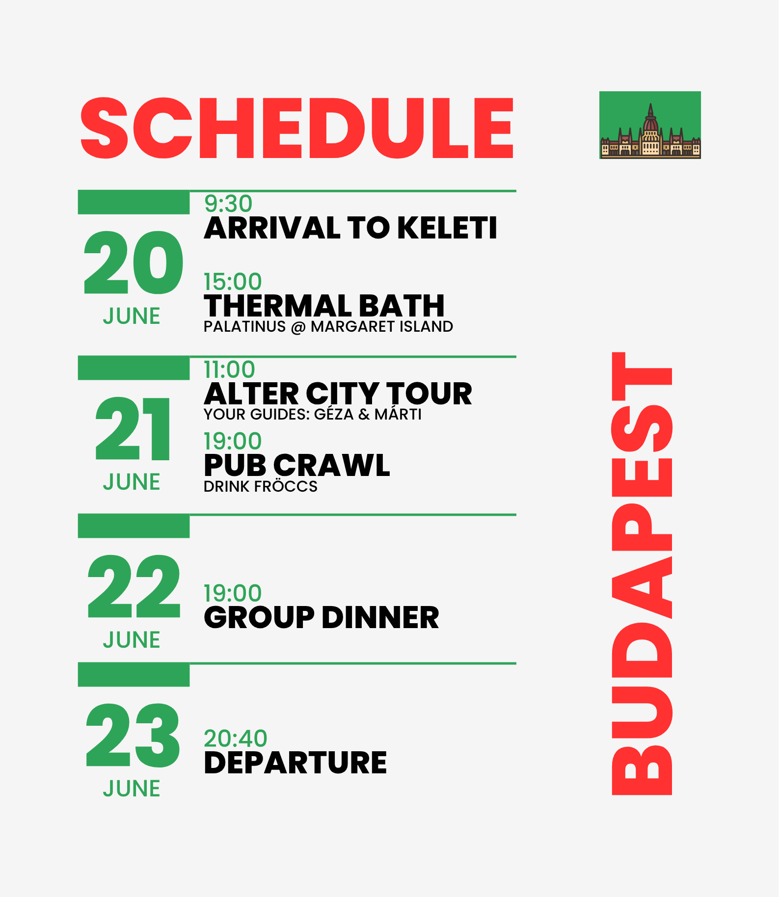
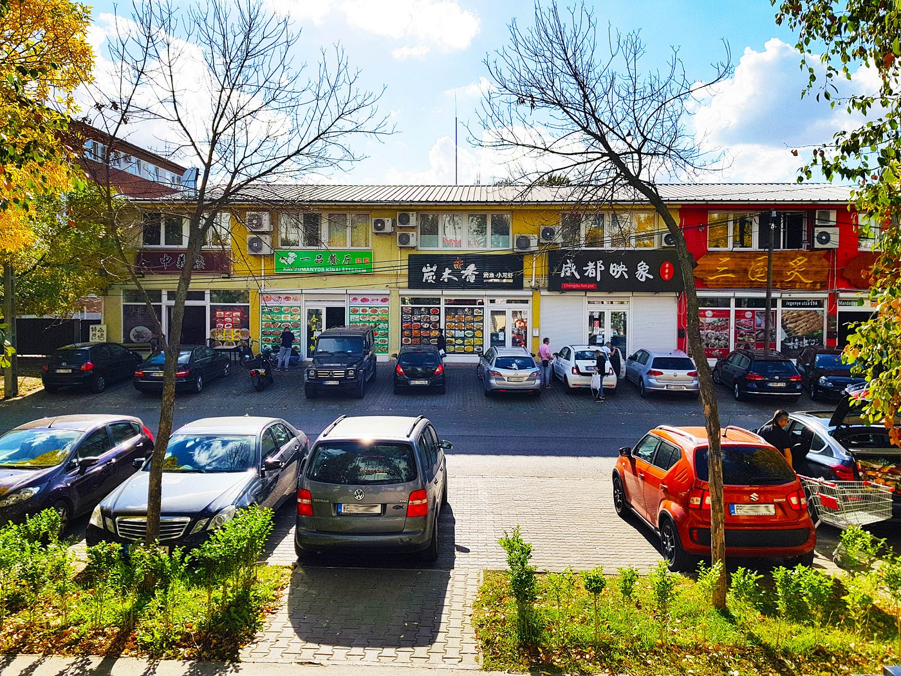
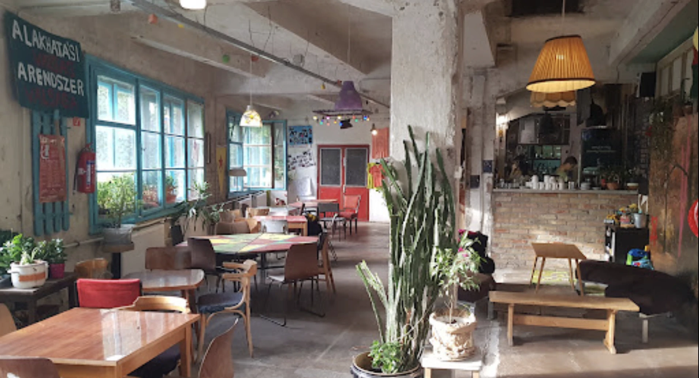
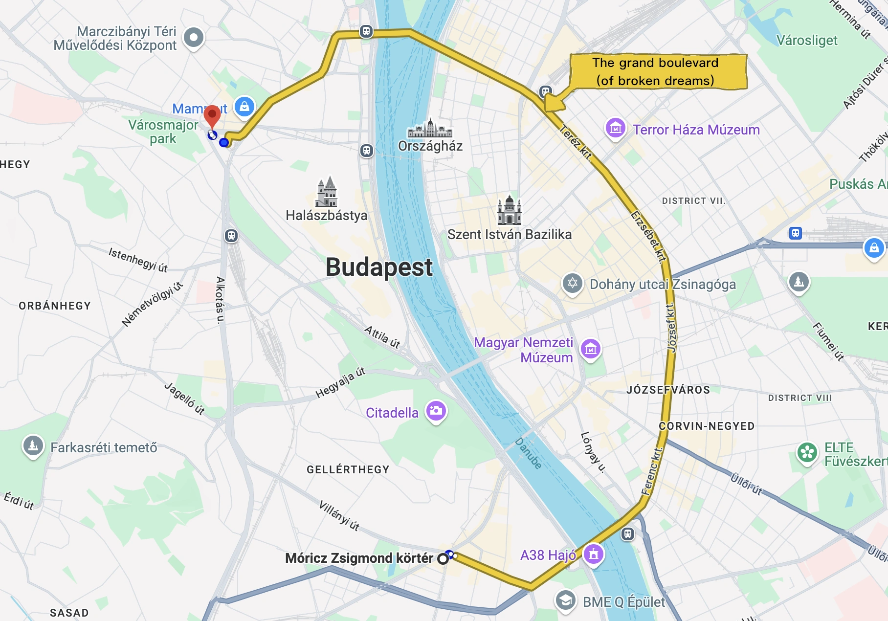
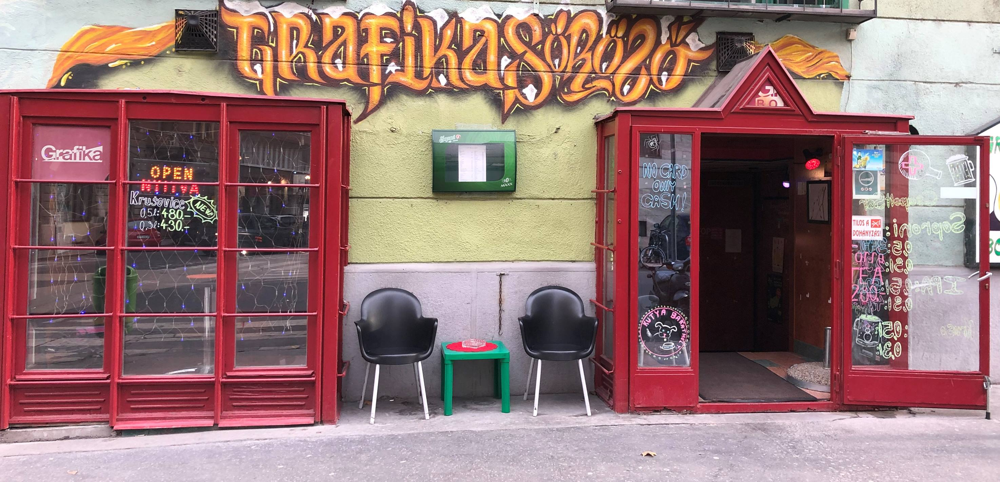

🏠 [1083 Budapest, Práter utca 24.](https://maps.app.goo.gl/reNrnG5XcAY845Fo7)

🚌 **Public transport:** <a href="https://play.google.com/store/apps/details?id=hu.webvalto.bkkfutar&pcampaignid=web_share">Android version</a> | [iOS version](https://apps.apple.com/hu/app/budapestgo/id916193835)

🚕 **Taxi** : <a href="https://play.google.com/store/apps/details?id=com.nerddevelopments.taxidriver.orderapp">Android version</a>
| [iOS version](https://apps.apple.com/hu/app/f%C5%91taxi/id794447291)

🏝️ **Beach**:
- [Kabin](https://maps.app.goo.gl/5Q8khqkbZGcaivDs9) - cool place on Szúnyog-sziget (= 🦟 Mosquito island, nomen est omen)
- [Nomád bár](https://maps.app.goo.gl/nYZr5zssWpaPeM777) - this is outside of Budapest, but the atmosphere is super: [it's fb page](https://www.facebook.com/nomadbar1692/?locale=hu_HU)
- [Római part](https://maps.app.goo.gl/cs1uvJ4zaHrVbtRz9) - it's a long coast, you'll find many bars and restaurants nearby.

🛍️ **Shops:** 
- [Magyar Írók boltja](https://maps.app.goo.gl/ThgnJNT91XrzXChQA) - Hungarian writers shop (bookstore)
- [Bortársaság](https://maps.app.goo.gl/uqQNEyAHw4wBn3Jy7) - Hungarian wine shop (Márti's favourite)
- [Szputnyik](https://maps.app.goo.gl/BoYcENTQ5gJu3Wt67) - Géza buys his fancy shirts here
- [Humana vintage](https://maps.app.goo.gl/DcXWoCkZh493APQ77) - Not as nice as Szputnyik, but a good secondhand store
- [Jajcia](https://maps.app.goo.gl/gbCnRaaVfYWhf4idA) - Alter secondhand store (Márti bought a pair of Martens for 20 CHF here)
- [Fővárosi Szabó Ervin Könyvtár](https://maps.app.goo.gl/doLqYVPkj6MJRh9q9) - Not a shop, but the most beautiful library in Budapest
- [Szia adománybolt](https://maps.app.goo.gl/2MaNMYnFsQgoJipp9) - Second hand clothes, quirky trinkets, pins and stickers, stuff you don't need but want
- [Massolit](https://maps.app.goo.gl/57ZGzf4sgSma7FE39) - Book store and Café
- [Nagycsarnok](https://maps.app.goo.gl/qJT2iMXsKUF1jhdC7) - Probably the most famous market in Budapest, kinda touristy but locals also buy food from there.

🍔 **Food:**
- [VAJ](https://maps.app.goo.gl/C5tjc5HoWurPkDXw5) - It's mostly the wealthy middle class and gentrifying hipsters who go there. It's delicious tho.
- [EPOCH Vegan Burger](https://maps.app.goo.gl/9tehMDqPSgrJx5gJA) - Best vegan burgers in Budapest
- [Vega city](https://maps.app.goo.gl/bWBeux3XTX8cz9qR7) - Vegan fast food, usually crowded during lunch time 
- [Kashmiri restaurant](https://maps.app.goo.gl/JeHQQP8PDPmmJeNMA) - Best food in the world, according to Géza
- [Frici papa](https://maps.app.goo.gl/FaQUg5dwK9TAtDW57) - Traditional Hungarian food, very atmospheric.
- [Csiga](https://maps.app.goo.gl/TTRD9Muh8JkkSCeN6) - A favorite spot of Budapest's left-wing intellectuals.
- [Cat Café](https://maps.app.goo.gl/yGV8ySN1JqVp5z6M7) - Purrfect place to have a coffee and pet cats.
- [Magvető Café](https://maps.app.goo.gl/FdP5iBfkvqYNRS6P6) - Cool place to drink a coffee and read
- [Ferdinánd Monarchia Restaurant](https://maps.app.goo.gl/wJX3v3jW3ktDwWBm7) - Traditional food
- [Hunyadi téri piac](https://maps.app.goo.gl/xZ6HWkAe6d3EGRZk7) - Best Lángos in Budapest according to Enikő. It's a market, so you'll find other food as well.
- [Lángos papi](https://maps.app.goo.gl/zjNg6n5H6cT8GK166) - Great Lángos (Enikő really likes this place)

🍻 **Pubs:**

Géza's top 5:

1. [Gólya](https://maps.app.goo.gl/EdGoqv8mk3cnbu5t5) - See the program ideas for more, this is the best pub in Budapest imo.
2. [Auróra](https://maps.app.goo.gl/mVMaSz2mDEMjeoAA9) - Has a permaculture garden, left wing activist place, atmospheric.
3. [Susuka](https://maps.app.goo.gl/nr5aEnDe7E5yQDYM7) - Not many people know this one. It's a small pub that mainly attracts alternative folks. 
4. [Élesztő](https://maps.app.goo.gl/w79ce1h1CrPkNLeCA) - This one is less of an alter pub, and more expensive, but you can drink great craftbeers here.
5. [Zuzmó](https://maps.app.goo.gl/eakqiSG4UPtCHjdJ6) - A friendly, relatively new place, close to our accommodation. 

Márti's top 5:
1. [Grafika](https://maps.app.goo.gl/WsMgBSPxtcb3b5cM6) - An icon, a legend. Cheap shots. Check this music video for vibez: [Beton.Hofi - DOHÁNYBOLT](https://youtu.be/fNhzpiQRApk?si=FFOsX-yniNbAQkVa)
2. [Tóth kocsma](https://maps.app.goo.gl/NHtsT2yBT72MdSz7A) - Charming retro pub in Hungarian style, traditional food served with lots of love. A true gem in the city.
3. [Rizmajer sörház](https://maps.app.goo.gl/v7VxrtHZpzNtAThB8) Not very cosy place, but you can have nice craft beers here.
4. [Macska](https://maps.app.goo.gl/KjXjdcWQjCPo9vLb8) Charming pub frequented by the leftist alter crowd. 'Macska' means 'cat', but there's no cat in the pub. We had our first date here.
5. [Palack borbar](https://maps.app.goo.gl/oYKKFMCAtHmZwmFG9) - Beautiful location by the river, delicious wines. Perfect for summer evenings

🚇 **Márti's know how about Budapest public transport**

🟣 BudapestGO app: Very useful for both planning and buying tickets. You can get physical tickets too if you prefer, but I really recommend using the app, it’s in English too. You can buy the passes in advance with the correct start date or when we get there. 

🎓 Monthly student pass – 3,450 HUF (~8 CHF)
Available for students who are EU / EEA / Swiss citizens and have a valid student ID.
It’s the best deal – you break even after about 7–8 single rides.
(I am very disappointed that it requires citizenship. Fuck that.)

🌍 If you’re not eligible for the student pass:
So if you’re not a student and/or not from the EU / EEA / Switzerland, these are your options for our 4-day stay:
Option A – combo of short-term passes
* ⁠  ⁠72-hour travelcard: 5,500 HUF (~13 CHF)
* 	24-hour travelcard: 2,500 HUF (~6.80 CHF)
* 	pay for each ride = 450 HUF/ticket (~1 CHF)
Option B – monthly pass (full price)
*  ⁠8,950 HUF (~21 CHF)

🎫 There is also a Budapest card. 72 hours for €76 , 96 hours for €90. Besides the public transport, this includes some free or discounted entries to museums and touristy places. It is only worth it if you want to spend the majority of your time with those things.

---
**Fun facts & cultural stuff below:**

---

Phrase of the day: _macskajaj_ - hangover, but the literal translation would be the german term 'Katzenjammer'.

**Movie selection:**

Here are some drama and sci-fi films from recent years. There's a link to the Filmio page (a Hungarian movie platform), where you can subscribe for a small monthly fee (2.75 CHF) or rent individual movies for around 1.5 CHF. But I suppose you might be able to find them elsewhere too.

(  )

<iframe src="https://www.youtube.com/embed/F5XeXNFNHQA" title="WHITE PLASTIC SKY - Official Trailer" frameborder="0" allow="accelerometer; autoplay; clipboard-write; encrypted-media; gyroscope; picture-in-picture; web-share" referrerpolicy="strict-origin-when-cross-origin" allowfullscreen></iframe>
An animated sci-fi film set in Budapest in the year 2123. Climate change has almost completely destroyed the planet, and the remaining survivors live in specially designed cities. It’s available on [Prime](https://www.primevideo.com/-/de/detail/White-Plastic-Sky/0RB3XYGIPCIBBDJF4853TEHGUK), but unfortunately without subtitles :( It’s also on Filmio, still no English subs tho.

<iframe src="https://www.youtube.com/embed/5dOZpivfNxw" title="Ruben Brandt, Collector | Official US Trailer (2018)" frameborder="0" allow="accelerometer; autoplay; clipboard-write; encrypted-media; gyroscope; picture-in-picture; web-share" referrerpolicy="strict-origin-when-cross-origin" allowfullscreen></iframe>
Ruben Brandt, Collector: Unique art style, interesting story, many art references. One of the best movies recently from Hungary. [Watch Online with eng subtitles](https://filmio.hu/film/ruben-brandt-a-gyujto-11512687)

<iframe src="https://www.youtube.com/embed/EhVI0DvQY3o" title="Hat hét (12) - Március 23-tól a mozikban // Teljes trailer, előzetes" frameborder="0" allow="accelerometer; autoplay; clipboard-write; encrypted-media; gyroscope; picture-in-picture; web-share" referrerpolicy="strict-origin-when-cross-origin" allowfullscreen></iframe>
Hat hét: Zsófi, the defiant teenager, gives up her newborn daughter through open adoption, but doubts begin to arise within her body and soul. According to Hungarian law, she has six weeks to change her mind. The title is a play of words, hat means six hét means seven (oh, but you already know this, right?) but hét also means week. [Watch Online with eng subtitles](https://filmio.hu/film/hat-het-14404196)

<iframe src="https://www.youtube.com/embed/DOmnKLKoWZw" title="LARRY | Trailer | English Subs | 2022" frameborder="0" allow="accelerometer; autoplay; clipboard-write; encrypted-media; gyroscope; picture-in-picture; web-share" referrerpolicy="strict-origin-when-cross-origin" allowfullscreen></iframe>
Larry - It tells the story of Adam who lives in isolation due to his stuttering, and hip-hop is the only way he can get rid of his speech impediment. [Watch Online with eng subtitles](https://filmio.hu/film/larry-13640523)

<iframe src="https://www.youtube.com/embed/Y1ggiLfxL2c" title="Háromezer számozott darab (16) előzetes" frameborder="0" allow="accelerometer; autoplay; clipboard-write; encrypted-media; gyroscope; picture-in-picture; web-share" referrerpolicy="strict-origin-when-cross-origin" allowfullscreen></iframe>
Three Thousand Numbered Pieces: A white Hungarian director rehearses a play with five young Roma actors. His play tells their real-life stories of abuse, drug addiction, and crime. However, instead of representing the truth of their experiences, it only capitalizes on their pain and exploits them.
[Watch Online with eng subtitles](https://filmio.hu/film/haromezer-szamozott-darab-14006927)

<iframe src="https://www.youtube.com/embed/N1gQ3eZCH8w" title="LIZA, A RÓKATÜNDÉR (Official trailer HD)" frameborder="0" allow="accelerometer; autoplay; clipboard-write; encrypted-media; gyroscope; picture-in-picture; web-share" referrerpolicy="strict-origin-when-cross-origin" allowfullscreen></iframe>
Liza, the Fox-Fairy: Liza is a 30-year-old, naïve, lonely nurse living in "Csudapest", the capital of a fictionalized 1970s Hungary with a capitalist system.  Liza is convinced that she has become a fox-fairy, a demon from Japanese mythology. According to the legend, men who fall in love with a fox-fairy die soon afterwards, and the fox-fairy is doomed to be alone forever... Sorry, I don't know where you can watch it online :(. 

---

**Some Hungarian music for getting in the mood:**

<iframe src="https://www.youtube.com/embed/P70feiZAOPI" title="Deva - Witchcraft (Official video)" frameborder="0" allow="accelerometer; autoplay; clipboard-write; encrypted-media; gyroscope; picture-in-picture; web-share" referrerpolicy="strict-origin-when-cross-origin" allowfullscreen></iframe>
Deva is like a modern day witch, fusing Hungarian folk songs with electronic music.  In 2022 she received the Music Moves Europe Award, becoming one of the few internationally recognized Hungarian musicians.

<iframe src="https://www.youtube.com/embed/MDO0kSSIf4I" title="Anima Sound System - Tekerd" frameborder="0" allow="accelerometer; autoplay; clipboard-write; encrypted-media; gyroscope; picture-in-picture; web-share" referrerpolicy="strict-origin-when-cross-origin" allowfullscreen></iframe>
Anima Sound System – Tekerd. One of the first Hungarian electronic music bands, they played acid-jazz and caused controversy in the media by [remixing the national anthem.](https://www.youtube.com/watch?v=RJs7h8rszRU&t=1386s) 

<iframe src="https://www.youtube.com/embed/ZYNzzy_G4Qw?list=OLAK5uy_mAwL_St94VPA_V6w8iW2x2aCkDWCIFFzk" title="We Plants Are Happy Plants" frameborder="0" allow="accelerometer; autoplay; clipboard-write; encrypted-media; gyroscope; picture-in-picture; web-share" referrerpolicy="strict-origin-when-cross-origin" allowfullscreen></iframe>
We Plants Are Happy Plants - We Plants Are Happy Plants. The guy is like the Hungarian edition of Vangelis, playing Chillstep / Progressive Trance.

<iframe src="https://www.youtube.com/embed/7YKoOD-eozg" title="Freakin&#39; Disco - Fox" frameborder="0" allow="accelerometer; autoplay; clipboard-write; encrypted-media; gyroscope; picture-in-picture; web-share" referrerpolicy="strict-origin-when-cross-origin" allowfullscreen></iframe>
Freakin’ Disco - Fox. They play instrumental electronic music and also won some international prizes. 

<iframe src="https://www.youtube.com/embed/CGt-rTDkMcM" title="Omega - Gyöngyhajú lány" frameborder="0" allow="accelerometer; autoplay; clipboard-write; encrypted-media; gyroscope; picture-in-picture; web-share" referrerpolicy="strict-origin-when-cross-origin" allowfullscreen></iframe>
Omega - Gyöngyhajú lány. Omega used to be the Hungarian Beatles, this is their most popular song. You might have heared it [in New Slaves](https://youtu.be/vQ0u09mFodw?t=172) as Kanye West decided to use it without permission.  

<iframe src="https://www.youtube.com/embed/fbPHLB4K7pE" title="Bohemian Betyars - Ellentétek Balladája // Official Music Video" frameborder="0" allow="accelerometer; autoplay; clipboard-write; encrypted-media; gyroscope; picture-in-picture; web-share" referrerpolicy="strict-origin-when-cross-origin" allowfullscreen></iframe>
Bohemian Betyars - Az ellentétek balladája. Hungarian Folk Punk band. The lyrics is a poem from [François Villon: Ballade du concours de Blois](https://www.bonjourpoesie.fr/lesgrandsclassiques/Poemes/fran%C3%A7ois_villon/ballade_du_concours_de_blois)

<iframe src="https://www.youtube.com/embed/xQNXU2XX79Y" title="Parno Graszt - A Muki fia / Son Of Muki" frameborder="0" allow="accelerometer; autoplay; clipboard-write; encrypted-media; gyroscope; picture-in-picture; web-share" referrerpolicy="strict-origin-when-cross-origin" allowfullscreen></iframe>
Parno Graszt - Muki fia. Arguably the most famous contemporary Gypsy band. 

<iframe src="https://www.youtube.com/embed/zxxxu2IbnWU" title="Kispál és a Borz - Csillag vagy fecske" frameborder="0" allow="accelerometer; autoplay; clipboard-write; encrypted-media; gyroscope; picture-in-picture; web-share" referrerpolicy="strict-origin-when-cross-origin" allowfullscreen></iframe>
Kispál és a Borz - Csillag vagy fecske. This is quite an old song, this band was the pioneer of the current hungarian alternative music scene.

<iframe src="https://www.youtube.com/embed/Lh9CKfMfD3E" title="Péterfy Bori &amp; Love Band - Oázis (Osztódással Szaporodó Szövegvideó)" frameborder="0" allow="accelerometer; autoplay; clipboard-write; encrypted-media; gyroscope; picture-in-picture; web-share" referrerpolicy="strict-origin-when-cross-origin" allowfullscreen></iframe>
Péterfy Bori - Oázis. Hungarian pop music, the singer's whole persona that she is hot.

<iframe src="https://www.youtube.com/embed/_MZ4eFEP9pg" title="Margaret Island - Engedd, hogy szabad legyek (HIVATALOS VIDEOKLIP)" frameborder="0" allow="accelerometer; autoplay; clipboard-write; encrypted-media; gyroscope; picture-in-picture; web-share" referrerpolicy="strict-origin-when-cross-origin" allowfullscreen></iframe>
Margaret Island - Engedd, hogy szabad legyek. Hungarian poppy alter. The lyrics sound like a love song, but it is actually about democracy.

---

**Hungarian language pack:**

Here are some fun facts and useful expressions that you can use to impress the locals.

**Counting:**

This song is unquestionably the best learning material to learn numbers 1-10. It randomly became a meme a few years ago, there are [remix versions like this](https://www.youtube.com/watch?v=WRqSFU346po), or this [super cute one](https://www.youtube.com/watch?v=HzWN-co2d_U). Singing makes learning easier:

  <iframe 
    src="https://www.youtube.com/embed/kXQ8WR5zRnE" 
    frameborder="0" 
    allowfullscreen>
  </iframe>

  🐴🐴🐴

**Greetings:**

   Jó reggelt (kívánok)!	[ˈjoː ˈrɛɡːɛlt ˈkiːvaːnok] ) Good morning 
    <audio id="joreggelt" src="/user/pages/01.home/jo_reggelt.mp3"></audio>

<button onclick="document.getElementById('joreggelt').play()">▶ Jó reggelt kívánok (G)</button>
 

   Jó napot (kívánok)!	[ˈjoː ˈnɒpot] ( [ˈkiːvaːnok] )	Good day
    <audio id="jonapot" src="/user/pages/01.home/jonapot.mp3"></audio>

<button onclick="document.getElementById('jonapot').play()">▶ Jó napot kívánok (M)</button>

Jó estét (kívánok)!	[ˈjoː ˈɛʃteːt] ( [ˈkiːvaːnok] )	Good evening 
    <audio id="joestet" src="/user/pages/01.home/joestet.mp3"></audio>

<button onclick="document.getElementById('joestet').play()">▶ Jó estét kívánok (G)</button>

   Szia!	[ˈsiɒ]	Hi / Bye (informal, singular)
    <audio id="szia" src="/user/pages/01.home/szia.mp3"></audio>

<button onclick="document.getElementById('szia').play()">▶ Szia (M)</button>

Sziasztok!	[ˈsiɒstok]	Hi / Bye (to more people)
    <audio id="sziasztok" src="/user/pages/01.home/sziasztok.mp3"></audio>

<button onclick="document.getElementById('sziasztok').play()">▶ Sziasztok (G)</button>

   Viszontlátásra	[ˈvisontˌlaːtaʃrɒ]	Goodbye (or in short: Viszlát! [ˈvislaːt])
    <audio id="viszlat" src="/user/pages/01.home/viszlat.mp3"></audio>

<button onclick="document.getElementById('viszlat').play()">▶ Viszontlátásra / Viszlát (M)</button>

 👋 👋 👋

**At a restaurant:**

Kérem	[ˈkeːrɛm]	Please 
    <audio id="kerem" src="/user/pages/01.home/kerem.mp3"></audio>

<button onclick="document.getElementById('kerem').play()">▶ Kérem (G)</button>

Nem kérem.	[ˈnɛm ˌkeːrɛm]	I don’t want (that)
    <audio id="nemkerem" src="/user/pages/01.home/nemkerem.mp3"></audio>

<button onclick="document.getElementById('nemkerem').play()">▶ Nem kérem (M)</button>

Köszönöm (szépen).	[ˈkøsøˌnøm] ( [ˈseːpɛn] )	Thank you (very much)
    <audio id="kosz" src="/user/pages/01.home/koszonom2.mp3"></audio>

<button onclick="document.getElementById('kosz').play()">▶ Köszönöm szépen (G)</button>

Elnézést (kérek).	[ˈɛlneːzeːʃt] ( [ˈkeːrɛk] )	Excuse me / Sorry
    <audio id="elnezest" src="/user/pages/01.home/elnezest.mp3"></audio>

<button onclick="document.getElementById('elnezest').play()">▶ Elnézést kérek (M)</button>

Külön fizetünk.	[ˈkyløn ˈfizɛtyːŋk]	We’ll pay separately
    <audio id="kulon" src="/user/pages/01.home/kulonfizetunk.mp3"></audio>

<button onclick="document.getElementById('kulon').play()">▶ Külön fizetünk (G)</button>

   Fizetni szeretnék.	[ˈfizɛtni ˌsɛrɛtnɛːk]	I’d like to pay
    <audio id="fizetnek" src="/user/pages/01.home/fizetnek.mp3"></audio>

<button onclick="document.getElementById('fizetnek').play()">▶ Fizetni szeretnék (M)</button>

Egy korsó sört kérek.	[ˈɛɟ ˌkorʃoː ˈʃørt ˌkeːrɛk]	A pint of beer, please.
    <audio id="korsot" src="/user/pages/01.home/egykorsot.mp3"></audio>

<button onclick="document.getElementById('korsot').play()">▶ Egy korsó sört kérek (G)</button>

   Egy capuccinót kérek zabtejjel.	[ˈɛɟ ˌt͡ʃɒput͡ʃiːnoːt ˌkeːrɛk ˈzɒbtɛjːɛl]	A cappuccino with oat milk, please.
    <audio id="cappucinot" src="/user/pages/01.home/capuccinot.mp3"></audio>

<button onclick="document.getElementById('cappucinot').play()">▶ Egy capuccinót kérek zabtejjel (M)</button>

 Egészségedre!	[ˈɛɡeːʃːeːɡɛdrɛ]	Cheers! / Bless you!
    <audio id="egi" src="/user/pages/01.home/egi.mp3"></audio>

<button onclick="document.getElementById('egi').play()">▶ Egészségedre (G)</button>

Nem beszélek magyarul.	[ˈnɛm ˌbɛsɛlɛk ˈmɒɟɒrul]	I don’t speak Hungarian
    <audio id="nembeszelek" src="/user/pages/01.home/nembeszelekmagyarul.mp3"></audio>

<button onclick="document.getElementById('nembeszelek').play()">▶ Nem beszélek magyarul (M)</button>

Hogy a macska rúgja meg! [ˈhoɟ ɒ ˈmɒt͡ʃkɒ ˈruːgjɒ ˈmɛɡ]	I wish the cat kicked it - see swearing section
    <audio id="macska" src="/user/pages/01.home/macskarugja.mp3"></audio>

<button onclick="document.getElementById('macska').play()">▶ Hogy a macska rúgja meg! (M)</button>

🐈🐈🐈 

**Duzen oder Siezen?**

This is just a fun fact about informal/formal speech in Hungarian. The German concept is closer to it's Hungarian usage, so let's see the examples in German. There is 1 form of 'Duzen', but you can 'Siezen' at least in 3 (!!) different ways:
- Mit gondolsz? (Was denkst du?) - speaking with friends and people around your age or younger than you. 
- Mit gondol? (Was denken sie?) - sounds neutral, using a common feature of Hungarian: [pronouns are often omitted because the subject is clear from the verb conjugation.](http://www.hungarianreference.com/Pronouns/omitting-keeping-pronouns.aspx?ForceDesktop=1) 
- Mit gondol ön? (Was denken sie?) - sounds official, respectful
- Mit gondol maga? (Was denken sie?) - "Maga" is often used in a less than polite or slightly confrontational way. In this case it's not necessarily rude, but not polite either. Funny enough, the letters are the same as in the abbreviation for "Make America Great Again."

You can safely use any of the sentences from the previous sections. 'Egészségedre' has a formal version, but let's not make our life harder.

**Swearing:**

Hungarian swearing culture is known for its broad and colorful expressions. Swearing is used to express frustration and anger, some of them are light (“I wish the cat kicked it!”, “Backwards with the greyhounds!” or "That brass angel whistling on a copper tree!") and there are pretty rude ones ("May God strike you", "To the whore of a life!" or "May I place you next to the funeral chapel."). The most common ones you will probably hear:

faszom [ˈfɒsom] - Fuck it. Literally means "my dick", but you can use it reagardless of your gender.

bazdmeg [ˈbɒzdmɛɡ] - Fuck / Scheiße, It’s a versatile swear word that Hungarians use like seasoning.

kurva [ˈkurvɒ] - it is used to emphasize something, literally means whore. e.g. 'kurva életbe' - fuck life (you don't like what's happening)  

Here's a video for illustration. Note that the swearing is a bit excessive here, but it comes so genuinely and fluently from the person - who's accidentally recording his neighbour's house collaping - that it's a bit funny for native speakers, as if this was a parody of how often we swear.

  <blockquote class="instagram-media" 
    data-instgrm-permalink="https://www.instagram.com/reel/DJLulfcsXE8/" 
    data-instgrm-version="14" 
    style="background:#FFF; border:0; margin: 1em auto; max-width:540px; width:100%;">
  </blockquote>

---

Dear friends, we have decided to organize a trip to Budapest for you, to show you the authentic Eastern European ~~reality~~ experience.

You'll find the practical info at the bottom of this page, but let's have a look first on what kind of programs we are planning:

Hungary is rich in thermal waters, making its baths, popularized by the Ottoman occupiers nearly 500 years ago, a must visit. The Lukács Thermal Bath is a historic indoor/outdoor thermal spa in Budapest, heated by natural hot springs. It features three thermal pools with temperatures of 32°C, 36°C, and 40°C, as well as a cooling pool at 24°C. Note: **the Sauna World is swimwear only! 👙**

* Day pass: 4800 Ft (~11 CHF)
* Sauna: 1200 Ft (~3 CHF)
* [List of other services](https://en.lukacsfurdo.hu/)

The image above is a scene from the second Dune movie. in reality, it is the Hungarian National Cemetery, specifically the Workers' Movement Pantheon in the Fiume Road Graveyard. It is an unexpectedly fascinating spot. It's more like a sculpture park than a traditional cemetery, many famous figures are buried here, making it an excellent place to explore history, culture, and shared values. In other words, it’s the perfect setting for a date (we actually came here on our second date!). There are official walking tours here, and there was a debate about building a recortan track for joggers inside the cemetery

* Entry fee: 0 Ft
* Official guided tour in english: 25000 Ft/group (57 CHF)
* Guided tour by Géza: 0 Ft
* [Official site](https://en.nori.gov.hu/heritage/fiumei-road-cemetery)

Budapest’s Chinatown, also known as the Monori Center, is just 15-25 minutes from the city center. Unlike other Chinatowns, which often brim with overt cultural landmarks, Budapest’s version is more like walking in China, according to Márti. Wandering through the neighbourhood, you’ll find a hidden world of authentic Chinese restaurants. There’s also a massive Chinese supermarket stocked with fresh vegetables, spices, and everything from woks to specialty foods.

Highlights include a summertime outdoor street food night market, dim sum shops, Sichuan cuisine, hand-pulled noodles, handmade dumplings, wok dishes, bubble tea, and more. Strangely enough, it even has its own police station staffed with officers from China. A friendly reminder of how far Beijing’s influence can reach 👀.

* Food in a restaurant: 2500-6500 Ft (5-15 CHF)

Gólya Presszó is the heart of left-wing movements in Budapest. Located in an old factory building (Ganz Works, founded by a [Swiss engineer](https://en.wikipedia.org/wiki/%C3%81brah%C3%A1m_Ganz) 150 years ago), it hosts offices for the IT cooperative, the Solidarity Economy Center, the Women for Each Other Movement, and more. You’ll also find a kindergarten, a training room, a workshop, the bike couriers’ organization, and the [chess club](https://www.facebook.com/golyasakk) founded by Géza.

* Sport fröccs (100 ml wine, 400 ml sparkling water): 800 Ft (~1,8 CHF)
* Beer (500 ml): 1200 Ft (~3 CHF)

Public transport in Budapest is excellent, with its backbone being the Grand Boulevard. Many small and alternative pubs and bars are located near the 4-6 tram line, as these trams run 24/7, ensuring you can always get home. Locals also prefer to live close to this line for the same convenience. Trams 4 and 6 share the same stops, except for the last three: tram 4 goes to Újbuda-központ, while tram 6 terminates at Móricz Zsigmond körtér. This is why locals refer to the line as 'négyeshatos,' which roughly translates to '4 and 6' in English. It sounds a bit like 'forensics', maybe I chose a _criminal_ translation.

* Adult travel pass for public transport (15 days): 5950 Ft (~13,5 CHF)
* Student pass (30 days): 3450 Ft (~8 CHF)

Márti's favourite pub (she used to live one level up). Located just a stone’s throw away from Bakáts tér in Budapest, Grafika is the kind of spot where time slows down. With its eclectic décor, mismatched furniture, and a menu that feels like ~~a curated mixtape of craft beers~~ it was designed by a stoner, Grafika is the perfect choice for those who appreciate the art of good conversation and cheap drinks. Especially the cheap drinks. 

* Beer (500 ml): 1500 Ft (~3,5 CHF)

Csepel Works, the pride of Hungarian socialist industry, stands as a shining beacon of progress and the tireless spirit of the working class! Founded in 1892, this great factory complex, located in the heart of Csepel, has grown under the guidance of the Party to become the engine of our People's Republic's industrial achievements.

Once a tool of capitalist exploitation, Csepel Works has been transformed through nationalisation into a fortress of collective labor, producing machinery, vehicles, and tools that fuel the building of socialism. Every hammer, every bicycle, every piece of equipment forged here is a testament to the strength and dedication of the Hungarian worker, who, shoulder to shoulder with comrades across the socialist bloc, marches toward a brighter, more prosperous future.

Through the unity of the people and the leadership of the Party, Csepel Works will continue to drive our nation forward, helping us achieve the glorious goals of the Five-Year Plan and ensuring Hungary's place among the vanguard of socialist progress!

Joking aside, this is a prime example of what went wrong with the socialist approach a few decades ago. If workers (rather than the state) had ownership of the means of production, working conditions would have been much better. Géza spent a summer working in a food factory here and can confirm this. The place is huge so walking here could take quite a bit of time, but rolling through on a scooter makes for a fun tour in a setting straight out of a movie scene.

* Entry: 0 Ft
* Renting an e-scooter for an hour: 5000 Ft (~11,5 CHF)

This long section on the shore of the Danube is Márti's absolute favourite spot in the city. It's the perfect way to start or end your night: enjoy sitting in the fugly and smelly green plastic things while pregaming for your favourite concert at Budapest Park, or lie down in the grass for a final chill before heading home or riding out the last wave of your edible. Many friendships and relationships have started and ended here. Márti even celebrated her 30th birthday here. One downside: there are no toilets. Luckily, Grafika is right around the corner, and the bartender (who is also called Márti) is super nice. I hope she still works there.

yours in adventure,

Márti & Géza